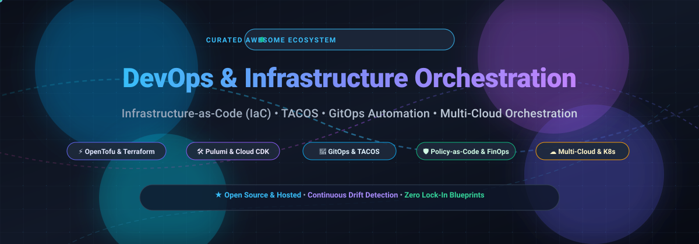

  

# 🚀 Awesome DevOps & Infrastructure Orchestration Ecosystem

  
  
  
  
  
  

---

## 📌 Executive Summary & Architecture Focus

**A definitive, SEO-optimized curated catalog of top-tier SaaS/hosted orchestration platforms and open-source DevOps projects.**

Focused on **Infrastructure-as-Code (IaC)**, **Declarative Cloud Provisioning**, **TACOS** (Terraform Automation and Collaboration Software), **Configuration Management**, **Policy-as-Code**, **FinOps**, and **GitOps Infrastructure Orchestration**.

This ecosystem guide tracks platforms designed to define, test, plan, provision, drift-detect, secure, and govern cloud and on-premise infrastructure across AWS, Azure, Google Cloud Platform (GCP), Kubernetes, and hybrid bare-metal clusters.

*Last updated: November 2026*

---

## 📑 Table of Contents
- [🌐 Sector Overview & Market Dynamics](#-sector-overview--market-dynamics)
- [☁️ SaaS / Hosted Platforms](#️-saas--hosted-platforms)
- [💻 Open-Source GitHub Projects](#-open-source-github-projects)
  - [⭐ Ranked by GitHub_Stars](#-ranked-by-github-stars)
  - [🏗️ Recommended Architecture Combinations](#️-recommended-architecture-combinations)
- [📈 Star History](#-star-history)
- [🤝 How to Contribute](#-how-to-contribute)
- [💖 Support & Sponsor](#-support--sponsor)
- [⚖️ Disclaimer & Security Guidance](#️-disclaimer--security-guidance)

---

## 🌐 Sector Overview & Market Dynamics

The global cloud infrastructure automation and DevOps orchestration market is estimated at **$12.5 billion in 2026**, projected to surge past **$35 billion by 2032** at an accelerating compound annual growth rate (CAGR) of over **18.5%**.

The sector exhibits **moderate fragmentation with a bifurcated dynamic**: while hyperscale cloud providers (AWS CloudFormation, Azure Resource Manager/Bicep, Google Cloud) command massive baseline infrastructure spend, the orchestration and governance layer (TACOS, multi-cloud IaC engines, and policy/drift automation) remains highly competitive and anti-lock-in, split between leading managed independent platforms (IBM/HashiCorp, Spacelift, Pulumi, Octopus Deploy) and community-driven, Linux Foundation/CNCF open-source ecosystems (OpenTofu, Crossplane, Ansible, Argo CD).

---

## ☁️ SaaS / Hosted Platforms

Below is the verified breakdown of leading SaaS and hosted infrastructure orchestration platforms, complete with specific tier entry pricing, concrete free-forever allowances or trial limits, and company size (valuation / revenue), sorted in descending order:

| Platform | Company Valuation / Revenue | Starting Tier Pricing | Free Tier / Trial Limits | Description |
| :--- | :--- | :--- | :--- | :--- |
| **[Azure Resource Manager & Azure Deployment Environments](https://microsoft.com)** | **Valuation: ~$3.1T** (Market Cap) / Revenue: ~$245B | **$0.00 / mo** (Free platform management; underlying Azure infrastructure resources billed as used) | **Free forever**: ADE service is free (subject to operational defaults of 200 deployment runtime mins/mo per region and 1 GB storage per environment) | Native Microsoft Azure deployment and governance layer orchestrating cloud resources via ARM JSON templates, Bicep, and role-based subscription blueprints. |
| **[AWS CloudFormation & AWS CDK](https://amazon.com)** | **Valuation: ~$2.1T** (Market Cap) / Revenue: ~$575B | **$0.00 / mo** (No charge for standard `AWS::*` resources; pay only for provisioned infrastructure. Custom extensions at $0.0009/handler op beyond free tier) | **Free forever**: Unlimited standard `AWS::*` resource management; 1,000 handler operations per month per account free for registry/custom extensions & hooks | Native AWS declarative infrastructure orchestration service modeling and provisioning AWS resources via YAML/JSON templates, StackSets, and programmatic CDK constructs. |
| **[Google Cloud Infrastructure Manager](https://google.com)** | **Valuation: ~$2.0T** (Market Cap) / Revenue: ~$307B | **$0.00 / mo** (Free for Terraform <=v1.5.7; for Terraform >=v1.16.5, $0.000000032/resource-second / ~$1.00/resource-year beyond 500 free resources) | **Free forever**: Unlimited resources on Terraform <=v1.5.7; first 500 concurrent managed resources per month (1.314B resource-seconds) free at $0.00 for Terraform >=v1.16.5 | Managed Google Cloud service automating deployment, state management, and drift tracking of GCP resources using Terraform/OpenTofu blueprints. |
| **[HCP Terraform & HashiCorp Cloud Platform (HCP)](https://hashicorp.com)** | **Valuation: $6.4B** (Acquired by IBM) / Revenue: ~$600M | **$0.10 / mo per managed resource** (Essentials plan, billed hourly at ~$0.00013/RUM) | **Free forever**: Up to 500 managed resources (RUM), unlimited users, 1 concurrent run, remote execution, and private module registry | Managed cloud Infrastructure-as-Code platform providing remote state locking, private module registries, drift detection, Sentinel/OPA policy checks, and HCP Vault/Consul integration. |
| **[Octopus Deploy](https://octopus.com)** | **Valuation: ~$625M** / Revenue: ~$83.4M ARR | **$360.83 / mo** ($4,330 / yr billed annually for Professional tier) | **Free forever**: Up to 10 targets/machines, 10 projects, 10 tenants, 10 users, and 1 space. Also provides a 30-day Enterprise free trial | Enterprise continuous delivery and runbook orchestration platform coordinating complex multi-environment deployments across Kubernetes, VMs, cloud PaaS, and hybrid infrastructure. |
| **[Pulumi Cloud](https://pulumi.com)** | **Valuation: ~$390M** / Revenue: ~$20M ARR ($99M funding) | **$40.00 / mo** (Team Essentials plan, includes up to 500 managed resources) | **Free forever**: Individual edition includes 1 user, unlimited managed resources, unlimited projects/stacks, and 500 deployment/workflow minutes/mo (1 concurrency) | Managed backend for Pulumi IaC offering encrypted state management, audit logs, Pulumi ESC (Environments, Secrets, and Configuration), and AI-assisted infrastructure authoring. |
| **[Spacelift](https://spacelift.io)** | **Valuation: ~$250M - $500M** / Revenue: ~$15M ARR ($73.6M funding) | **$399.00 / mo** (Starter tier for up to 10 users and 2 public workers) | **Free forever**: Up to 2 users, 1 API key, core IaC workflows (Terraform, OpenTofu, Pulumi, CloudFormation, Ansible), and VCS integration. Also offers a 14-day free trial of paid tiers | Sophisticated CI/CD and infrastructure orchestration platform supporting OpenTofu, Terraform, Pulumi, CloudFormation, Ansible, and Kubernetes with Rego policy-as-code and stack dependencies. |
| **[env0](https://env0.com)** | **Valuation: ~$72M** / Revenue: ~$5.5M ARR ($42M funding) | **$0.00 / mo** (Free tier; paid Cloud Navigator / Cloud Pilot enterprise tiers start at custom quote based on active environments) | **Free forever**: Up to 30 active environments, 250 runs/mo, 1 concurrent deployment, unlimited users, and 1 self-hosted agent | Enterprise self-service cloud infrastructure automation platform featuring dynamic cost estimation, RBAC governance, drift detection, and multi-framework IaC workflows. |
| **[ControlMonkey](https://controlmonkey.io)** | **Valuation: ~$25M - $50M** ($7M Seed funding) | **$800.00 / mo** (Essentials tier for automated drift detection and IaC management) | **Free tier / trial**: Permanent Free Resilience Assessment (read-only cloud & SaaS posture evaluation); custom POC / demo free trial upon booking sales evaluation | Cloud governance and Terraform/OpenTofu automation platform featuring one-click legacy cloud-to-IaC code generation, continuous drift alerts, and disaster-recovery snapshots. |
| **[Scalr](https://scalr.com)** | **Valuation: Bootstrapped / VC** / Revenue: ~$5.3M ARR ($7.35M Series A) | **$0.99 / run** (Pay-as-you-go per apply/dry run beyond the monthly free allowance) | **Free forever**: Up to 50 runs per month with drift detection and Open Policy Agent (OPA) integration included | Hierarchical Terraform and OpenTofu remote operations backend designed for decentralized enterprise teams with OPA policy enforcement and federated module registries. |

---

## 💻 Open-Source GitHub Projects

### ⭐ Ranked by GitHub_Stars

Every major open-source infrastructure-as-code engine, configuration manager, GitOps operator, policy scanner, and orchestration runner sorted strictly in descending order of GitHub stargazers:

1. **[Ansible](https://github.com/ansible/ansible)**   
   🔧 *Industry-standard open-source agentless IT automation and configuration management engine orchestrating server provisioning, OS hardening, and multi-tier application rollouts over SSH/WinRM.*

2. **[LocalStack](https://github.com/localstack/localstack)**   
   ☁️ *A fully functional local AWS cloud stack enabling developers to test Infrastructure-as-Code (Terraform, CDK, Serverless) and cloud apps entirely offline.*

3. **[Herdr](https://github.com/herdrdev/herdr)**   
   ⚡ *High-performance open-source DevOps and infrastructure orchestration utility engineered for streamlined multi-environment coordination and automated deployment workflows.*

4. **[Terraform](https://github.com/hashicorp/terraform)**   
   🌐 *The foundational declarative Infrastructure-as-Code tool for provisioning and managing multi-cloud resources across hundreds of providers using HashiCorp Configuration Language (HCL).*

5. **[Trivy](https://github.com/aquasecurity/trivy)**   
   🛡️ *Comprehensive security and vulnerability scanner for container images, file systems, Git repositories, Kubernetes clusters, and IaC templates (Terraform, CloudFormation, Dockerfile).*

6. **[OpenTofu](https://github.com/opentofu/opentofu)**   
   ✨ *Flagship Linux Foundation open-source (MPL-2.0) fork of Terraform providing full HCL compatibility, client-side state encryption, early variable evaluation, and community-driven providers.*

7. **[Pulumi](https://github.com/pulumi/pulumi)**   
   💻 *Modern open-source Infrastructure-as-Code SDK enabling developers to define, test, and orchestrate cloud infrastructure using general-purpose programming languages (TypeScript, Python, Go, C#, Java) and YAML.*

8. **[Argo CD](https://github.com/argoproj/argo-cd)**   
   🔄 *Declarative, GitOps continuous delivery tool for Kubernetes, automating the synchronization and lifecycle management of infrastructure and application states.*

9. **[Packer](https://github.com/hashicorp/packer)**   
   📦 *Automated creation of identical golden machine images (AWS AMIs, Azure VHDs, GCP images, VMware, Proxmox templates) from a single declarative configuration.*

10. **[AWS CDK](https://github.com/aws/aws-cdk)**   
    🏗️ *The AWS Cloud Development Kit (CDK), an open-source software development framework to define cloud infrastructure in modern programming languages and provision it through AWS CloudFormation.*

11. **[Infracost](https://github.com/infracost/infracost)**   
    💰 *Cloud cost estimates for Terraform and OpenTofu directly in pull requests, providing proactive FinOps governance before resources are created.*

12. **[Open Policy Agent — OPA](https://github.com/open-policy-agent/opa)**   
    🚦 *General-purpose open-source policy engine and declarative Rego language enforcing security, compliance, and governance guardrails across IaC, microservices, and Kubernetes.*

13. **[Crossplane](https://github.com/crossplane/crossplane)**   
    ☸️ *CNCF open-source control-plane framework extending Kubernetes into a universal cloud orchestrator, allowing platform teams to assemble declarative self-service cloud infrastructure APIs.*

14. **[Terragrunt](https://github.com/gruntwork-io/terragrunt)**   
    🧱 *Thin open-source wrapper for OpenTofu and Terraform that keeps configurations DRY across multi-account, multi-region environments and orchestrates stack dependency DAGs.*

15. **[Atlantis](https://github.com/runatlantis/atlantis)**   
    💬 *Self-hosted GitOps automation for OpenTofu and Terraform pull-request workflows, executing plans and applies directly through PR comments with locking.*

16. **[Checkov](https://github.com/bridgecrewio/checkov)**   
    🔍 *Static analysis tool for Infrastructure-as-Code preventing security and compliance misconfigurations in Terraform, CloudFormation, Bicep, Helm, and Kubernetes.*

17. **[Flux CD](https://github.com/fluxcd/flux2)**   
    🔁 *Open and extensible continuous delivery solution for Kubernetes powered by the GitOps Toolkit, providing automated synchronization and drift reconciliation.*

18. **[Digger](https://github.com/diggerhq/digger)**   
    ⛏️ *Open-source GitOps orchestration tool running OpenTofu and Terraform securely inside your existing CI runners (GitHub Actions, GitLab CI) without sharing cloud keys.*

19. **[CDK for Terraform — CDKTF](https://github.com/hashicorp/terraform-cdk)**   
    🧩 *Define Terraform and OpenTofu infrastructure using familiar programming languages like TypeScript, Python, Go, C#, and Java.*

20. **[Azure Bicep](https://github.com/Azure/bicep)**   
    🔷 *Domain-Specific Language (DSL) providing clean syntax, immediate validation, and first-class modularity for deploying Azure resources declaratively.*

21. **[Terramate](https://github.com/terramate-io/terramate)**   
    ⚡ *High-performance open-source IaC orchestrator and code generator featuring blast-radius reduction, change detection, DAG stack execution, and drift tracking.*

22. **[Colmena (Nix / NixOS)](https://github.com/nix-community/colmena)**   
    ❄️ *Simple, stateless NixOS deployment tool orchestrating bit-for-bit reproducible fleets over SSH with parallel rollouts.*

23. **[Kpt](https://github.com/kptdev/kpt)**   
    📦 *Kubernetes-native package management tool for declarative Resource Configuration Management (KRM) with automated validation and pipelines.*

24. **[TofuController / Flux TF-Controller](https://github.com/flux-iac/tofu-controller)**   
    🤖 *Kubernetes GitOps operator enabling continuous reconciliation and self-healing drift correction of OpenTofu and Terraform resources natively in cluster.*

---

### 🏗️ Recommended Architecture Combinations

- **Enterprise Multi-Account Baseline**: Combine **OpenTofu + Terragrunt** for modular, DRY multi-region cloud topology.
- **Pull Request GitOps CI**: Pair **Atlantis** or **Digger** with GitHub Actions for transparent peer-reviewed pull-request approvals.
- **Continuous Shift-Left Guardrails**: Integrate **Checkov + Trivy + OPA** for policy and vulnerability scanning, plus **Infracost** for automatic pull-request cost analysis.
- **Kube-Centric Platform Engineering**: Deploy **Crossplane + Argo CD / Flux** to deliver internal developer platforms with custom self-healing cloud APIs.
- **OS & Bare-Metal Fleet Provisioning**: Coordinate **Packer** (golden image creation) with **Ansible** or **Colmena (NixOS)** for post-boot configuration management.

---

## 📈 Star History

---

## 🤝 How to Contribute

Contributions are wholeheartedly welcome! Follow these steps to submit additions or improvements:

1. 🍴 **Fork the repository** on GitHub.
2. 🌿 **Create a new branch**: `git checkout -b feature/add-new-orchestration-tool`.
3. 📝 **Add or edit entries in `README.md`**: Follow existing formatting guidelines, ensure links are valid, and include accurate pricing/star data.
4. 💡 **Ensure factual claims**: Provide official links for documentation, source code, or pricing tiers.
5. 🚀 **Submit a Pull Request** with a concise description of your changes.

---

## 💖 Support & Sponsor

Thank you for exploring and utilizing this DevOps & Infrastructure Orchestration catalog! If you find this repository valuable to your engineering workflows, platform architecture, or study:

- ⭐ **Star this repository** to help other engineers and platform teams discover it!
- 🍴 **Fork and share** it with your colleagues, teammates, and communities on LinkedIn, X/Twitter, and Reddit.
- ☕ **Buy me a coffee / Sponsor my work**: Support ongoing maintenance, research, and curation through the [GitHub Sponsor Dashboard](https://github.com/sponsors/ishandutta2007)!

  

---

## ⚖️ Disclaimer & Security Guidance

- **Community-Curated**: This list is independently curated for educational and architectural reference — inclusion does not represent an endorsement.
- **Licensing Transparency**: Note licensing considerations across tools (e.g., Terraform 1.6+ and Packer are governed by BUSL 1.1; OpenTofu is MPL-2.0; Pulumi, Crossplane, Atlantis, and Argo CD are Apache 2.0; Ansible is GPL-3.0).
- **Secrets & State Management**: Infrastructure state files (`.tfstate`) frequently hold highly sensitive plaintext secrets (database credentials, TLS keys, cloud access tokens). Always employ client-side encryption, lock states in dedicated remote backends, and implement strict least-privilege IAM policies.

---

  Crafted with care for DevOps Engineers, SREs, Cloud Architects, and Platform Teams worldwide.

